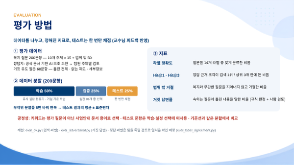
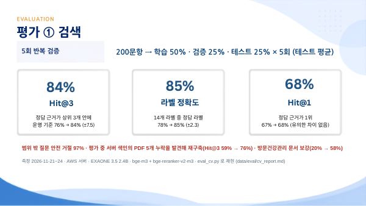
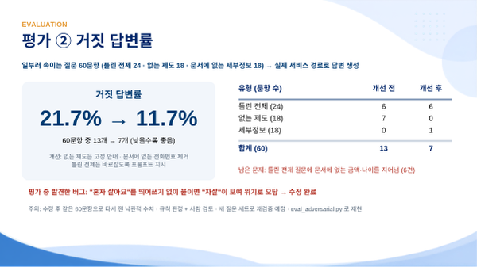
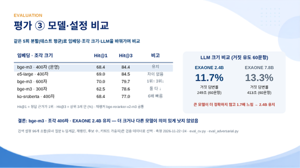

# 대전노인복지 HUB — 독거노인 복지 안내 · 이상신호 감지 AI

### On-device LLM + RAG for elderly welfare (Daejeon) · AI Project II 8조 (민뚜쩌 · 박희재 · 오랑거)

대전광역시 독거노인(2025년 76,662명)을 위한 복지 상담 AI입니다.

- 어르신이 글·사진·음성으로 물으면 **대전·보건복지부 공공문서에 근거(RAG)** 해서 답합니다.
- 대화 속 **위기·우울·증상 반복** 같은 이상신호를 감지해 **사회복지사(관리자) 화면**에 알립니다.
- 검색·재랭킹·이상신호 분석·답변 생성은 모두 **자체 GPU 서버(Ollama)** 에서 실행합니다. 외부 AI API 없이도 동작합니다.

> **실서비스:** <https://aiproject2.duckdns.org> (AWS GPU 서버 · systemd 상시 실행 · HTTPS · 앱처럼 설치하는 PWA)
> 서버 인스턴스가 꺼져 있으면 접속할 수 없습니다.

---

## 1. 주요 기능

| 기능 | 내용 | 코드 |
|---|---|---|
| **복지 상담 (RAG)** | 질문 라벨 분류 → bge-m3 검색(후보 20) → 재랭킹 → 관련성 게이트 → EXAONE 3.5 답변 | `src/pipeline.py`, `src/rag_pipeline.py` |
| **위기 안전장치** | "죽고 싶어요" 같은 표현은 검색·생성 없이 **109·119·129 고정 안내**, 관리자에게 '위기' 알림 | `src/crisis.py` |
| **이상신호 감지** | 감정 점수 · 증상 반복 · LLM 판정 → 정상/주의/위험 | `src/abnormal_signal.py` |
| **관리자(사회복지사) 화면** | 관리자 계정으로 로그인하면 **전체 어르신의 이상신호 모니터**(어르신별 카드·타임라인) | `src/admin_monitor.py`, `scripts/create_admin.py` |
| **맞춤 복지** | 나이·소득·구·독거·거동·질환 정보로 받을 수 있는 복지를 카드로 추천 | `src/welfare_rules.py` |
| **맞춤 복지 상세 화면** | 카드를 누르면 받을 수 있는 이유·대상·지원 내용·신청 방법·문의처·출처를 표시(챗봇 경유 없음). 식사배달은 사는 구의 수행기관 전화번호 | `src/welfare_details.py` |
| **사진 이해** | 고지서·약봉투 사진 → Gemini(키 있을 때) → 서버 안 `qwen2.5vl:3b` → OCR 순서로 자동 전환 | `src/image_reader.py` |
| **환각 방지** | 문서에 없는 전화번호·번호 조각 제거, **없는 제도 확인**(질문 속 제도 이름이 근거에 없으면 생성하지 않음), 영어 답변 차단, 틀린 전제 바로잡기 규칙 | `src/llm.py` |
| **접근성** | 큰 글씨(3단계) · 고대비(7:1) · 폰 16px 이상 · 동작 줄이기 대응 애니메이션 | `app.py` |
| 음성 대화 | Whisper STT + 핸즈프리(VAD) — **실험 단계** | `app.py`, `src/vad_stream.py` |

---

## 2. 시스템 구조

```
어르신 입력 (문자 · 사진 · 음성)
   │
   ├─ 위기 표현?        ─▶ 109·119·129 고정 안내 + 관리자 '위기' 알림 (검색·생성 없음)
   ├─ 인사·잡담?        ─▶ 짧고 따뜻한 대화
   ├─ 복지와 무관?      ─▶ 정중히 거절 + 주민센터 안내 (검색 없음)
   │
   ├─ 질문 라벨 분류 (14개 라벨: 복지 10개 주제 + 기타 복지 · 범위 밖 · 잡담 · 위기)
   ├─ 검색: bge-m3 후보 20개 → bge-reranker-v2-m3 재랭킹 (+ 라벨 키워드 가점 0.1)
   ├─ 없는 제도 확인: 질문 속 제도 이름이 근거에 없으면 → "자료에서 확인되지 않는 제도" 안내
   ├─ 관련성 게이트: 1위 관련성 < 0.25 → 지어내지 않고 주민센터 안내
   ├─ EXAONE 3.5 2.4B (Ollama) — 근거 문서만으로 답변 (에이전트: 도구 선택·복합 질문 분해)
   └─ 후처리: 문서에 없는 전화번호·'(예시)' 제거, 영어 답변 차단
   │
   └─ (항상) 이상신호 분석 → 주의/위험이면 관리자 화면에 알림
```

### 질문 라벨 체계 (교수님 피드백 반영)
출력은 항상 정해진 **14개 라벨 중 하나**입니다. 판정 순서와 키워드는 [`docs/LABELS.md`](docs/LABELS.md)에 정리되어 있습니다.

1. **위기** → **잡담** → **범위 밖** (규칙)
2. **10개 주제**: 문서 용어 키워드 점수가 가장 높은 주제
3. 키워드가 없으면 → **학습 질문 유사도**("끼니 챙기기 힘들어요" → 무료급식)
4. 그래도 없으면 → **기타 복지**

**예측 점수의 정의**

| 점수 | 정의 |
|---|---|
| 관련성 | 재랭커 로짓의 시그모이드(0~1) |
| 순위 | 관련성 + 0.1 × [조각이 라벨 키워드를 포함] |
| 게이트 | 가점 없는 원래 관련성으로 판단 |

---

## 3. 평가 결과 (2026-11-21, AWS 서버 · EXAONE 3.5 2.4B · bge-m3 · 색인 4,409조각)

> 모든 수치는 아래 명령으로 다시 만들 수 있습니다. 실행 환경과 일시는 각 리포트에 함께 기록됩니다.

### 3-1. 복지 질문 검색 — 학습 50% / 검증 25% / 테스트 25% × 5회 반복
정답지 200문항(복지 150 + 범위 밖 50 · 공식 문서 기반, **AI 보조 초안 → 팀원 주제별 검토**, 문항별 라벨은 팀원 독립 검토 진행 중)을 주제 비율을 유지해 나누고, 시드 42~46으로 5번 반복했습니다.

- **학습**: 유사 질문 분류기 학습
- **검증**: 하이퍼파라미터 576개 조합(유사 질문 k 3 × 유사도 임계값 4 × 재랭커 2 × 후보 수 2 × 키워드 가점 4 × 거절 게이트 3) 중 선택
- **테스트**: 1회만 측정. 같은 문항으로 **현재 운영 설정(기준선)**도 함께 측정

| 지표 (평균 ± 표준편차) | 기준선 | 검증으로 고른 설정 |
|---|---|---|
| 라벨 정확도(14개) | 78.4% ± 3.3 | **84.8% ± 2.3** |
| Hit@1 | 66.8% ± 5.8 | 68.4% ± 4.7 (유의한 차이 없음) |
| Hit@3 | 79.6% ± 6.0 | **84.4% ± 7.5** |
| 범위 밖 거절율 | 96.8% ± 4.4 | 96.8% ± 4.4 |

**피드백 루프 · 4-fold 교차검증 (교수님 피드백 11-24)** — `tune.py`

```bash
python3 tune.py              # for 루프로 k·임계값·하이퍼파라미터·거절 게이트(576개 조합)를 바꿔 가며 검증 정확도 측정
                             # → 목표(기본 라벨 정확도 95%) 이상이면 즉시 멈춤, 아니면 끝까지 돌고 최고값 선택
                             # ① 4-fold(학습 50/검증 25/테스트 25, 모든 문항이 테스트에 한 번)로 이 방법의 성능 추정
                             # ② 4개 검증 fold 평균이 가장 좋은 설정을 코드북 data/best_params.json 으로 저장 (앱이 읽어 사용)
                             # 재랭커는 ON 고정: OFF 가 Hit@1 은 조금 높았지만 거짓 답변 1 → 4 로 늘어남 (--rerank both 로 비교 가능)
python3 eval_cv.py cv --folds 4   # 위 표의 검증 방식을 4-fold 로 (→ data/eval/cv_report_4fold.md)
```
`src/config.py` 는 `data/best_params.json` 의 후보 수·재랭커·키워드 가점·게이트·유사 질문 k·임계값을 기본값으로 읽습니다
(환경변수가 있으면 환경변수 우선, 파일이 없으면 기존 기본값). 코드북은 서버에서 만들고 git 에는 올리지 않습니다.

**개선 과정 (같은 테스트 문항)**

| 단계 | Hit@1 | Hit@3 | 원인 |
|---|---|---|---|
| 서버의 옛 색인 (PDF 5개 누락) | 44.4% | 58.8% | 에너지바우처·자살예방·기초연금 문서 없음 |
| 색인 재구축 | 64.7% | 75.9% | **코퍼스 정상화** |
| + 방문건강관리 문서 보강 | 66.8% | 79.6% | **코퍼스 보강** (방문건강관리 Hit@3 20% → 58%) |
| + 라벨 키워드 가점·후보 20 | 68.4% | **84.4%** | **검색 개선** |

**임베딩 모델 · 청크 크기 비교 (2026-11-24)**

각 설정마다 검증으로 하이퍼파라미터를 따로 고른 뒤, 같은 테스트 문항으로 측정했습니다 (평균 ± 표준편차).

| 검색 설정 | 조각 수 | Hit@1 | Hit@3 | 임베딩 시간(GPU) |
|---|---|---|---|---|
| **bge-m3 · 청크 400 (운영)** | 4,409 | 68.4% ± 4.7 | **84.4% ± 7.5** | 150초 |
| bge-m3 · 청크 300 | 5,871 | 62.5% ± 8.1 | 78.6% ± 3.5 | 151초 |
| bge-m3 · 청크 600 | 2,984 | 70.0% ± 3.8 | 79.7% ± 3.2 | 150초 |
| multilingual-e5-large · 청크 400 | 4,409 | 69.0% ± 6.0 | 84.5% ± 5.0 | 152초 |
| ko-sroberta-multitask · 청크 400 | 4,409 | 68.4% ± 9.3 | 77.0% ± 6.4 | **25초** |

- **결론: 현재 운영 설정(bge-m3 · 청크 400)을 유지합니다.**
  - multilingual-e5-large는 오차 범위 안에서 동률입니다.
  - 청크 300은 모든 지표가 낮습니다.
  - 청크 600과 ko-sroberta는 Hit@3가 4~7%p 낮습니다. 다만 ko-sroberta는 임베딩이 6배 빠릅니다.
- 주의: 5개 설정을 한꺼번에 놓고 검증 점수로 고르면, 검증 50문항에서 우연히 좋았던 설정이 뽑혀 테스트 Hit@3가 78.6%로 오히려 낮아졌습니다. 그래서 설정 비교는 위 표처럼 **설정별로 따로** 봅니다.
- 주의: Hit@K는 '정답 키워드가 조각에 들어 있는가'로 판정하므로 청크가 클수록 유리합니다. 청크 크기 간 비교는 이 점을 감안해야 합니다.

재현:
```bash
python eval_cv.py dump                                                  # 운영 인덱스
EMBED_DEVICE=cuda python eval_cv.py dump --embed intfloat/multilingual-e5-large
EMBED_DEVICE=cuda python eval_cv.py dump --embed jhgan/ko-sroberta-multitask
EMBED_DEVICE=cuda python eval_cv.py dump --chunk-size 300
EMBED_DEVICE=cuda python eval_cv.py dump --chunk-size 600
python eval_cv.py cv                                                    # → data/eval/cv_report.md
```

### 3-2. 거짓 답변률 — 거짓 유도 질문 60개
- 질문: [`data/eval/adversarial_rag.jsonl`](data/eval/adversarial_rag.jsonl) — 틀린 전제 24 · 없는 제도 18 · 문서에 없는 세부정보 18
- 답변 경로: 실제 서비스와 같은 경로
- 판정: 규칙 기반 자동 판정(정정/안전/거짓/검토 필요) + 사람 1차 검토 → [`data/eval/adversarial_round1_review.md`](data/eval/adversarial_round1_review.md)

| 유형 | 수정 전 거짓 | 수정 후 거짓 |
|---|---|---|
| 틀린 전제 (24) | 6 | 6 |
| 없는 제도 (18) | 7 | **0** |
| 문서에 없는 세부정보 (18) | 0 | 1 |
| **전체** | **13/60 = 21.7%** | **7/60 = 11.7%** |

- 수정 내용: 없는 제도 확인 규칙 · 프롬프트 규칙 8(전제 바로잡기) · 번호 조각/영어 답변 차단 · 위기 오탐 수정
- 부작용 확인: 정상 복지 질문 150개 중 '없는 제도'로 잘못 막힌 질문 **0개**
- ⚠️ '없는 제도 확인' 규칙은 같은 60문항의 실패를 보고 만들었으므로 **수정 후 수치는 낙관적**입니다. 새 질문으로 독립 검증할 예정입니다.
- **모델 비교 (같은 60문항)**: EXAONE 2.4B 거짓 11.7% · 249초 vs **7.8B 거짓 13.3% · 413초(약 1.7배 느림)**
  → 큰 모델이 거짓 답변을 줄이지 못해 **서비스는 2.4B 유지**. 남은 실패는 두 모델 모두 '근거에 없는 숫자(금액·나이)를 지어내는 것'입니다.

재현:
```bash
python eval_adversarial.py      # → data/eval/adversarial_report.md · adversarial_review.csv(팀 검토용)
```

### 3-3. 기존 지표 (2026-11-14, 200문항 1회 측정)
- 검색 Hit@1 63% · Hit@3 75% · 범위 밖 거절 98%
- 이상신호 '위험' 재현율 **20%** (위기 키워드 보강 전). 보강한 표현 일부가 평가 문장과 겹쳐서 **새 문장 세트로 재측정 예정**입니다.

재현:
```bash
RAG_REINDEX=1 python eval_ground_truth.py     # → data/eval/eval_report.md
```
이 스크립트는 기존 프로토콜과 비교할 수 있도록 라벨 가점을 끄고(후보 10) 측정합니다.

### 평가하면서 찾아 고친 문제
- 🚨 **위기 오탐**: "혼자 살아요"만 말해도 띄어쓰기를 지우면 "혼자살"에 '자살'이 들어가 109 위기 안내와 관리자 알림이 발생 → 수정
- **서버 색인 누락**: 11-09에 추가한 PDF 5개가 서버 색인에 반영되지 않았음 → 재구축
- **정답지 오류**: "기초연금 며칠에 입금?"을 '문서에 없음'으로 적었으나 실제로는 문서에 있음(매월 25일) → 데이터 수정
- **자동 판정 허점**: 확인 문구를 붙이고 틀린 숫자를 말하는 답이 '안전'으로 판정됨 → 판정 규칙 보완

### 발표 자료 — 평가 슬라이드 (2026-11-24)



| 평가 ① 검색 (5회 반복 검증) | 평가 ② 거짓 답변률 |
|---|---|
|  |  |
| **평가 ③ 모델·설정 비교** | **한계와 정직한 평가** |
|  |  |

---

## 4. 설치 · 실행

```bash
pip install -r requirements.txt
ollama pull exaone3.5:2.4b                     # 답변 LLM (온디바이스)
ollama pull qwen2.5vl:3b                       # (선택) 사진 이해

export LLM_BACKEND=ollama LLM_MODEL=exaone3.5:2.4b
python -m streamlit run app.py                 # 어르신용 포털 (관리자 계정 로그인 시 관리자 화면)
```

- 첫 실행 때 `data/welfare_docs/`를 색인합니다. 문서를 바꿨다면 `RAG_REINDEX=1`로 다시 색인하세요.
- 관리자 계정 만들기: `python3 scripts/create_admin.py` (이름은 `ADMIN_USERS`, 기본 "관리자", 비밀번호 8자 이상)
- 별도 관리자 앱(선택): `ADMIN_PW=... streamlit run app_admin.py --server.port 8502`

### 주요 환경변수

| 변수 | 기본값 | 설명 |
|---|---|---|
| `LLM_BACKEND` | `openai` (서버는 `ollama`) | `ollama` / `gemini` / `openai` |
| `LLM_MODEL` | `exaone3.5:2.4b` | Ollama 답변 모델 |
| `USE_AGENT` | `1` | 에이전트 경로. `0`이면 결정형 RAG |
| `RAG_CANDIDATES` | `20` | 재랭킹 전 후보 수 (5회 검증으로 선택) |
| `RAG_KEYWORD_BOOST` | `0.1` | 라벨 키워드 가점. `0`이면 예전과 동일 |
| `RAG_LABEL_FALLBACK` | `1` | 키워드 없는 질문에 학습 질문 유사도 사용 |
| `RAG_MIN_RELEVANCE` | `0.25` | 관련성 게이트 |
| `SERVICE_CHECK` | `1` | 없는 제도 확인 |
| `RAG_REINDEX` | `0` | `1`이면 색인 재구축 |
| `GEMINI_API_KEY` | (없음) | 있으면 사진을 Gemini vision으로 분석. **코드·저장소에 넣지 말 것** |
| `OLLAMA_VISION_MODEL` | `qwen2.5vl:3b` | 서버 안 사진 이해 모델 |
| `ADMIN_USERS` | `관리자` | 관리자 계정 이름(쉼표로 여러 개) |
| `USE_MYSQL` | `0` | `1`이면 MySQL, 아니면 JSON 파일 |

---

## 5. 서버 운영 (AWS)

| 구성 | 내용 |
|---|---|
| 상시 실행 | `deploy/welfarehub-8003.service` (systemd, 오류·재부팅 시 자동 재시작) |
| 비밀값 | 서버의 `/etc/welfarehub.env` (권한 600)에만 저장 |
| HTTPS | Apache 가상호스트 `deploy/apache-aiproject2.conf` + Let's Encrypt(snap certbot) — `deploy/HTTPS.md` |
| 도메인 | DuckDNS `aiproject2.duckdns.org` |

```bash
# 코드 업데이트
cd ~/team/novem/ondevice_llm && git pull origin main && sudo systemctl restart welfarehub-8003

# 문서를 추가·삭제했을 때: 색인 재구축 (10~20분, 그동안 사이트 중단, 중간에 끊지 말 것)
sudo systemctl stop welfarehub-8003
RAG_REINDEX=1 python3 -c "from src.rag_pipeline import RagPipeline; print(RagPipeline(use_rerank=False).index(), '조각')"
sudo systemctl start welfarehub-8003
```

⚠️ 인스턴스를 **중지(stop)하면 공인 IP가 바뀝니다.** 이때는 DuckDNS 주소를 갱신해야 합니다. **종료(terminate)는 절대 하지 마세요.**

---

## 6. 데이터

`data/welfare_docs/`에 넣은 문서가 자동으로 색인됩니다. 지원 형식은 PDF, MD/TXT, CSV, XLS/XLSX입니다. HWP는 PDF로 바꿔서 넣습니다.

| 문서 | 출처 |
|---|---|
| 2025 노인보건복지 사업안내 1·2권 | 보건복지부 |
| 2025 기초연금 사업안내 | 보건복지부 |
| 2025 자살예방사업 안내 | 보건복지부 |
| 2025 에너지바우처 사업 시행계획 | 산업통상자원부 |
| 방문건강관리 (2026 통합건강증진사업 총괄 안내서 부록 84~86쪽 발췌, 담당자 연락처 제외) | 보건복지부 |
| 대전 노인맞춤돌봄·재가노인 식사배달·자치구별 시설 현황 | 대전광역시 공공데이터 |

- 주소 목록 성격의 '현황' 스프레드시트는 검색 잡음이 되어 색인에서 제외합니다 (`RAG_EXCLUDE_DOCS`).
- 개인정보(`data/users.json`, `profiles.json`, `chat_logs.json`, `alerts.json`)와 `data/.app_secret`은 `.gitignore`로 커밋하지 않습니다.

---

## 7. 파일 구성 (주요)

| 경로 | 역할 |
|---|---|
| `app.py` | 어르신용 Streamlit 포털(로그인·맞춤 복지·상세 화면·AI 상담·사진·관리자 화면·PWA) |
| `src/pipeline.py` | 전체 흐름(위기 → 잡담 → 범위 밖 → 없는 제도 확인 → 에이전트/RAG) |
| `src/rag_pipeline.py` | 문서 로딩·정제·청킹·색인·검색(라벨 키워드 가점) |
| `src/topic_labels.py` | 14개 라벨·라벨 키워드·학습 질문 유사도 분류 |
| `src/llm.py` | LLM 클라이언트, 답변 프롬프트, `ground_answer`, 없는 제도 확인 |
| `src/crisis.py` | 위기 표현 감지 + 고정 안내 (앱·파이프라인·이상신호 공용) |
| `src/abnormal_signal.py` | 이상신호(감정·증상 반복·baseline·LLM 판정) |
| `src/agent.py` | 에이전트(도구 호출 + 다중 의도 분해) |
| `src/admin_monitor.py` | 관리자 이상신호 모니터 화면 |
| `src/welfare_rules.py`, `src/welfare_details.py` | 맞춤 복지 자격 규칙 · 상세 안내 |
| `src/image_reader.py` | 사진 이해(Gemini → qwen2.5vl → OCR) |
| `src/db.py` | 계정(비밀번호 해시)·프로필·대화·알림 저장(MySQL 또는 JSON) |
| `eval_cv.py` | 50/25/25 × 5회 반복 검증 + 하이퍼파라미터 탐색 |
| `eval_adversarial.py` | 거짓 유도 질문 60개 → 거짓 답변률 |
| `eval_ground_truth.py` | 기존 200문항 1회 평가(검색·이상신호) |
| `docs/LABELS.md` | 라벨 정의·키워드·점수 정의·평가 데이터 설명 |
| `deploy/` | systemd·Apache·HTTPS·배포 가이드 |
| `scripts/create_admin.py` | 관리자 계정 생성 |

---

## 8. 한계와 다음 단계

- **틀린 전제 정정**: 질문 속 틀린 숫자를 따라 말하거나 근거에 없는 금액·나이를 지어내는 경향이 남아 있습니다(25%). 7.8B로 바꿔도 줄지 않았습니다 → 답변 속 숫자를 근거와 대조하는 후처리가 다음 과제입니다.
- **독립 검증**: 거짓 유도 질문의 사람 판정(팀원 2명), 규칙을 보지 않은 팀원이 쓴 새 '없는 제도' 질문으로 재측정해야 합니다.
- **이상신호**: 평가 데이터가 19개(위험 5개)로 적습니다. 새 문장 세트로 재현율을 다시 측정해야 합니다.
- **약한 주제**: 노인맞춤돌봄 Hit@3 40~45%, 방문건강관리 58%
- **응답 속도**: 답변·사진 분석이 수십 초 걸릴 수 있습니다.
- **음성**: WebRTC는 UDP 연결이 필요해 서버 보안그룹 설정에 따라 연결되지 않을 수 있습니다(실험 단계).
- **현장 실증**: 실제 어르신 대상 파일럿 검증이 필요합니다.

---

## 참고문헌

- Lewis et al. *Retrieval-Augmented Generation for Knowledge-Intensive NLP Tasks.* NeurIPS 2020. arXiv:2005.11401
- Chen et al. *M3-Embedding (BGE-M3).* ACL 2024 Findings. arXiv:2402.03216
- Nogueira & Cho. *Passage Re-ranking with BERT.* arXiv:1901.04085
- LG AI Research. *EXAONE 3.5.* arXiv:2412.04862
- Qwen Team. *Qwen2.5 Technical Report.* arXiv:2412.15115
- Radford et al. *Robust Speech Recognition via Large-Scale Weak Supervision (Whisper).* ICML 2023. arXiv:2212.04356
